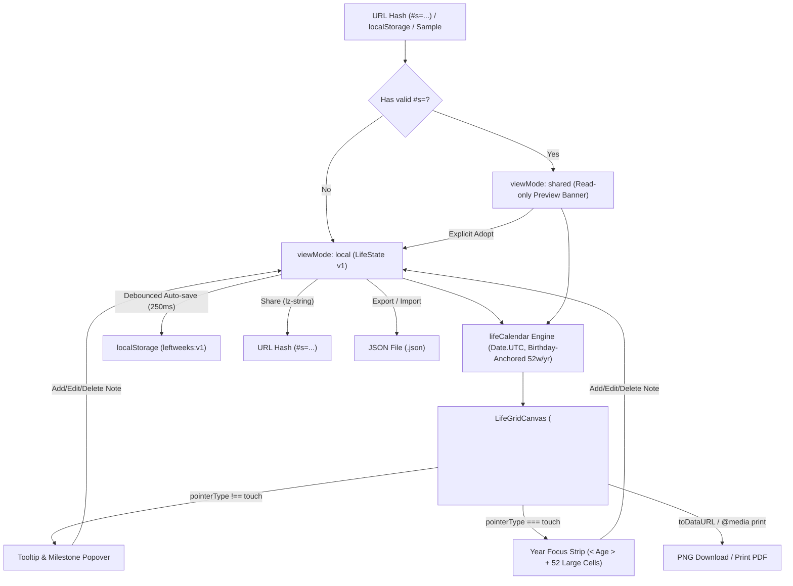

# Leftweeks Interactive SPA Design Document

- **Author:** fkt
- **Date:** 2026-11-20
- **Status:** Reviewed & Updated

## The Problem

현재 `leftweeks`는 Python 3.12와 `matplotlib`에 의존하는 CLI 도구로, 터미널에서 생년월일을 입력하면 90년×52주 고정 격자의 정적 PDF 파일(`lifeweeks.pdf`)만 생성한다. 이 구조는 다음과 같은 사용자 경험 한계를 가진다.

1. **높은 진입 장벽**: Python 환경과 패키지 설치(`uv` 등)가 필요해 비개발자나 모바일 사용자가 즉시 접근하기 어렵다.
2. **정적 출력의 한계**: 출력된 PDF에서는 특정 칸이 정확히 어느 날짜·나이인지 확인할 수 없고, 기대 수명을 바꿔 보거나 자신의 인생 이벤트를 기록하는 상호작용이 불가능하다.
3. **주차 계산 오차**: 기존 `src/leftweeks/plot.py`의 `round((days_lived / 365.25) * 52)` 근사 방식은 연도당 잔여 일수(1.2425일)를 보정하지 않아 고령 구간에서 행(나이)과 실제 날짜가 어긋난다.
4. **공유 및 보관 불편**: 수정할 때마다 CLI를 다시 실행해 PDF를 재생성해야 하며, 개인 기록을 포함하거나 제외해 링크·파일로 공유하는 수단이 없다.

## Overview

기존 Python CLI를 제거하고, GitHub Actions를 통해 GitHub Pages에 자동 배포되는 클라이언트 전용 싱글 페이지 애플리케이션(SPA)으로 전환한다.

사용자는 브라우저에서 URL에 접속하자마자 샘플 차트로 인터랙션을 체험하고, 자신의 생년월일을 입력해 주차별 인생 그래프를 즉시 확인할 수 있다. 기대 수명 슬라이더 조작에 따라 그래프가 실시간으로 갱신되며, 데스크톱에서는 호버·클릭·키보드로, 모바일에서는 연도 확대 UI를 통해 각 주의 정확한 날짜 범위와 만 나이를 확인하고 색상 태그가 붙은 짧은 메모를 기록할 수 있다. 모든 데이터는 서버 없이 브라우저 로컬(`localStorage`, URL 해시, JSON 파일)에서만 처리되며 한국어와 영어를 모두 지원한다.

## Goals

- **설치 없는 즉시 접근**: GitHub Pages 정적 호스팅을 통해 데스크톱과 모바일 브라우저에서 즉시 실행된다.
- **정확하고 반응형인 인터랙티브 그래프**: 생일 기준으로 각 연도 행을 고정해 날짜 오차를 제거하고, 기대 수명(50~120세) 조절 시 실시간으로 렌더링한다.
- **모바일 사용성 확보**: 375px 폭의 스마트폰에서도 52열 그리드의 특정 주를 정확히 선택·조회·편집할 수 있는 인터랙션을 제공한다.
- **로컬 우선 저장 및 안전한 공유**: 서버 없이 `localStorage` 자동 저장, URL 해시(`#`) 압축 공유(메모 포함 여부 선택, 기존 로컬 데이터 보호), JSON 파일 내보내기/가져오기를 제공한다.
- **기존 출력물 활용성 계승**: 고해상도 PNG 다운로드 및 브라우저 인쇄용 스타일(`@media print`)을 지원한다.
- **이중 언어 지원**: UI, 날짜 포맷, 나이 표기(한국어 `만 N세` 포함)를 한국어(`ko`)와 영어(`en`)로 전환할 수 있다.
- **깔끔한 저장소 전환**: 기존 Python CLI 마지막 커밋에 `v0.1.0-python-cli` 태그를 남긴 뒤 Python 관련 파일을 제거하고 SPA 프로젝트로 일원화한다.

## Non-Goals

- **백엔드 및 계정 시스템**: 서버 API, 외부 데이터베이스, 로그인/동기화 기능은 구축하지 않는다.
- **기존 Python CLI 유지보수**: `click`/`matplotlib` 기반 CLI 및 PyPI 배포는 중단한다.
- **주당 다중·장문 다이어리**: 주당 단일 짧은 메모(최대 120자)와 태그 1개로 제한하며, 리치 텍스트 에디터나 파일 첨부는 다루지 않는다.
- **실시간 협업 편집**: 다중 사용자 동시 편집 기능은 범위에서 제외한다.

## Technical Plan

### 1. System Architecture & Data Flow

애플리케이션은 백엔드 없이 브라우저 내부에서만 동작하는 정적 SPA(`Vite + TypeScript + React + Tailwind CSS`)로 구성한다.

- **초기화 및 공유 모드 분리 (`viewMode: "local" | "shared"`)**:
  - URL 해시(`#s=...`)가 유효하면 `viewMode: "shared"`(읽기 전용 미리보기)로 렌더링하고 **`localStorage`에 자동 저장하지 않는다**. 상단 배너에 **"내 차트로 저장(덮어쓰기)"** 및 **"내 차트로 돌아가기"** 버튼을 제공해 기존 사용자의 로컬 데이터를 보호한다.
  - URL 해시가 없거나 손상된 경우 `localStorage` (`leftweeks:v1`) → 기본 샘플 데이터(`1995-01-01`) 순으로 `viewMode: "local"` 상태를 초기화한다.
- **저장 디바운스**: 슬라이더 드래그 중에는 메모리 상태로만 캔버스를 60fps 갱신하고, `localStorage` 쓰기는 250ms 디바운스(또는 `pointerup`)로 분리한다.



### 2. Date & Week Engine (`src/lib/lifeCalendar.ts`)

- **UTC 순수 달력 연산 (타임존/DST 오차 방지)**: `"YYYY-MM-DD"` 문자열은 `new Date(str)` 대신 연·월·일을 분리해 `Date.UTC(y, m - 1, d)`로 변환한다. 로컬 오늘 날짜(`today`) 역시 `Date.UTC(now.getFullYear(), now.getMonth(), now.getDate())`로 정규화하고, `Intl.DateTimeFormat` 호출 시 `timeZone: "UTC"`를 지정한다.
- **생일 기준 행 고정**: 행 `year` (`0 <= year < lifeExpectancy`)의 시작일은 `birthDate + year`년으로 계산한다. 윤년(2월 29일) 출생자는 평년에서 2월 28일을 기준일로 일관 처리한다.
- **주차 범위 계산**: 각 연도 행은 52개 열(`week` `0..51`)로 구성된다.
  - `week 0..50`: 각 7일 (`rowStart + week * 7일` ~ `+6일`).
  - `week 51`: `rowStart + 51 * 7일`부터 `nextRowStart - 1일`까지(평년 8일, 윤년 9일 자동 처리).
- **경계 상태 판정**:
  - 미래 생년월일(`today < birthDate`): 모든 셀을 `remaining`으로 표시하고 `current` 셀은 없다.
  - 기대 수명 초과 나이(`today >= finalRowEnd`): 모든 셀을 `lived`로 표시하고 `current` 셀은 없다.
- **요약 통계 (`buildLifeSummary`)**: `livedWeeks`, `remainingWeeks`, `totalWeeks`, `percentLived`, `currentAge` 필드를 반환해 상단 요약 바에 표시한다.

### 3. Canvas Grid Renderer & Accessibility (`src/components/LifeGridCanvas.tsx`)

- **렌더링**: 52열 × `lifeExpectancy`행(50~120행)을 단일 HTML5 `<canvas>`에 그린다. `window.devicePixelRatio`를 반영해 고해상도 화면에서 선명하게 출력한다.
- **정밀 O(1) 히트 테스트**: `getBoundingClientRect()` 기준 CSS 픽셀 좌표에서 축 레이블 여백(`gridOffsetX`, `gridOffsetY`)을 빼고, 셀 크기 + 간격(`cellSize + gap`)으로 나눈 뒤 나머지 좌표가 간격(gutter) 또는 격자 밖이면 `null`을 반환한다.
- **시각 구분**: `lived`(중간 톤 채움), `current`(강조 테두리/포인트 컬러), `remaining`(연한 테두리/빈 칸), `milestone`(사용자가 지정한 카테고리 색상 채움 또는 점 표시).
- **키보드 및 스크린 리더 접근성**: `<canvas tabIndex={0}>`에 방향키(`ArrowUp/Down/Left/Right`) 가상 커서(`focusedCell`)와 `Enter`(메모 편집 열기)를 지원하고, 단일 `aria-live="polite"` 영역으로 현재 포커스된 주의 날짜 범위·나이·메모를 안내한다.
- **출력물 지원**: 오프스크린 고해상도(2x~3x) `<canvas>`로 제목·생년월일·범례를 포함한 PNG 다운로드를 제공한다. 인쇄 시에는 `@media print` 스타일로 컨트롤 바를 숨기고 차트와 인쇄 전용 이벤트 목록(`EventListPrint`)만 출력한다.

### 4. Desktop & Mobile Interaction

- **분기 기준**: `PointerEvent.pointerType === "touch"`(또는 `(pointer: coarse)` 미디어 쿼리)일 때 모바일 인터랙션으로 라우팅하고, `"mouse"`/`"pen"`일 때 데스크톱 인터랙션으로 라우팅한다.
- **데스크톱**: 마우스 이동 시 DOM 기반 경량 툴팁으로 해당 주의 날짜 범위, 나이(`만 N세` / `Age N`), 메모 요약을 표시한다. 셀 클릭 시 메모 편집 팝오버를 연다.
- **모바일(터치 환경)**: 전체 `<canvas>`를 한눈에 보는 오버뷰로 표시한다. 특정 연도(행)를 탭하면 화면 하단에 **Year Focus Strip** 시트가 열려 해당 연도의 52주를 44×44px 이상 터치 가능한 버튼 그리드로 확대 표시한다. 6px 행 오탭을 즉시 보정할 수 있도록 시트 헤더에 **이전/다음 연도 버튼(`< 만 29세 >`)**을 제공한다.

### 5. State Schema, Persistence & Sharing (`src/lib/storage.ts`, `src/lib/shareUrl.ts`)

- **버전 관리 스키마 (`LifeState`)**:
  ```ts
  type NoteColor = "blue" | "green" | "amber" | "rose" | "purple";
  interface WeekNote {
    text: string;   // 최대 120자
    color: NoteColor;
  }
  interface LifeState {
    v: 1;
    birthDate: string;                  // YYYY-MM-DD
    lifeExpectancy: number;             // 50..120, 기본값 90
    notes: Record<string, WeekNote>;    // key: "${year}-${week}"
    locale: "ko" | "en";
  }
  ```
- **범위 외 메모 비파괴 보존**: `lifeExpectancy`를 줄여도 `year >= lifeExpectancy`인 메모는 삭제하지 않고 `notes`에 유지(렌더링만 제외)한다.
- **URL 해시 공유**: `lz-string`의 `compressToEncodedURIComponent`로 minified `LifeState` JSON(`JSON.stringify`)을 압축해 `#s=<payload>`에 저장한다. 공유 모달에서 **"메모 포함"** 토글(기본값: `false`)을 제공하며, 생성된 URL이 2,000자를 초과하면 경고를 띄우고 JSON 파일 내보내기를 안내한다.
- **비신뢰 입력 방어 및 예외 처리**: JSON 가져오기뿐 아니라 URL 해시와 `localStorage` 로드 시에도 동일한 스키마 검증기(`validateLifeState`, 프로토타입 오염 키 `__proto__`/`constructor`/`prototype` 차단 포함)를 통과시킨다. 모든 `localStorage` 접근은 `try/catch`로 감싸 시크릿 모드·용량 초과 시 메모리 폴백으로 동작한다.

### 6. Bilingual Support (`src/i18n/`)

- `src/i18n/ko.ts`, `src/i18n/en.ts` 정적 딕셔너리를 사용하고 초기 언어는 `localStorage` → `navigator.language` 순으로 결정한다.
- 날짜 포맷은 `Intl.DateTimeFormat(locale, { timeZone: "UTC" })`을 사용하며, 한국어 나이 표기는 `만 N세`로 통일한다.
- 시스템 폰트 스택을 사용해 별도 한글 웹폰트 번들 없이 초기 로딩 속도를 유지한다.

### 7. GitHub Pages Deployment & Repository Transition

- 기존 Python CLI 파일(`src/leftweeks/`, `pyproject.toml`, `uv.lock`, `.python-version`, `lifeweeks.pdf`)을 삭제하기 전, 현재 `HEAD`에 `v0.1.0-python-cli` Git 태그를 생성한다.
- `vite.config.ts`에 `base: "/leftweeks/"`를 설정하고 `package-lock.json`을 커밋한다.
- `.github/workflows/deploy.yml`에 `permissions` (`contents: read`, `pages: write`, `id-token: write`), `environment: github-pages`, `concurrency` (`group: pages`)를 설정하고 `main` 푸시 시 `npm ci && npm test && npm run build` 후 `actions/configure-pages`, `actions/upload-pages-artifact`, `actions/deploy-pages`로 배포한다.

## Alternatives Considered

### 1. SVG (`4,680 <rect>`) 또는 HTML CSS Grid (`4,680 <div>`) 렌더링
- **내용**: 52×90(최대 52×120) 셀을 개별 SVG `<rect>` 또는 HTML `<div>` 노드로 렌더링하여 기본 CSS 호버와 포커스를 활용하는 방식.
- **기각 사유 (작성자 결정)**: 기대 수명 슬라이더를 실시간으로 드래그할 때 수천 개의 DOM/SVG 노드를 재계산·리페인트하면 중급 이하 모바일 기기에서 프레임 드롭과 메모리 부담이 크다. 단일 `<canvas>`와 경량 DOM 오버레이 조합이 60fps 반응성과 고해상도 PNG 내보내기 모두에 유리하다.

### 2. URL 쿼리 파라미터(`?birth=...&notes=...`) 기반 공유
- **내용**: 생년월일과 메모 데이터를 쿼리 스트링으로 직렬화해 공유 링크를 생성하는 방식.
- **기각 사유 (작성자 결정)**: 쿼리 파라미터는 서버·CDN·GitHub Pages 접근 로그와 `Referer` 헤더에 그대로 기록되어 생년월일 및 개인 메모가 외부로 유출될 위험이 있다. 서버로 전송되지 않는 URL 해시(`#s=...`)와 압축 방식을 채택했다.

### 3. 단순 7일 누적 또는 `365.25` 근사 주차 계산
- **내용**: 기존 `src/leftweeks/plot.py`의 `round((days_lived / 365.25) * 52)` 방식이나 출생일로부터 7일씩 단순 누적해 52주마다 줄바꿈하는 방식.
- **기각 사유 (작성자 결정)**: 1년은 52주 + 1.2425일이므로 단순 7일 누적은 90세 시점에 약 16주의 오차가 발생해 "N번째 행 = 만 N세"라는 시각적 기준이 깨진다. 각 행을 생일 기준으로 고정하고 51주차에 잔여 일수(1~2일)를 흡수하는 방식으로 대체했다.

### 4. 빌드 도구 없는 순수 Vanilla JS
- **내용**: 프레임워크나 번들러 없이 단일 HTML/JS 파일로 구현하는 방식.
- **기각 사유 (작성자 결정)**: 초기 번들은 가장 작지만, 모바일 연도 확대 시트, 메모 편집 모달, `ko`/`en` 이중 언어 전환, 상태 압축 및 JSON 스키마 검증까지 수동 DOM 조작으로 유지하면 코드 결합도와 버그 위험이 커진다. `Vite + TypeScript + React + Tailwind CSS`가 정적 배포 호환성과 유지보수성 면에서 유리하다.

### 5. 기존 Python CLI와 SPA 병행 유지
- **내용**: `src/leftweeks/` Python 패키지를 유지하면서 별도 디렉터리에 웹 앱을 추가하는 방식.
- **기각 사유 (작성자 결정)**: 웹 앱이 PNG 다운로드 및 인쇄용 PDF 출력을 모두 대체할 수 있어 Python CLI를 별도로 유지보수할 필요가 없다. 삭제 전 `v0.1.0-python-cli` Git 태그로 이력만 보존하고 저장소를 SPA 중심으로 단일화한다.

## Detailed Implementation

아래 작업은 단일 구현 목록으로 순서대로 수행하며, 실제 코드 대신 파일별 변경 내용과 역할을 명시한다.

### 1. 저장소 전환 및 기존 Python CLI 정리
1. **Git 태그 생성 (`v0.1.0-python-cli`)**: Python 파일을 제거하기 전 현재 `HEAD`에 태그를 남겨 기존 CLI 이력을 보존한다.
2. **삭제할 파일**:
   - `src/leftweeks/__init__.py` — 기존 Python 패키지 초기화 파일 제거.
   - `src/leftweeks/cli.py` — 기존 `click` CLI 진입점 제거.
   - `src/leftweeks/plot.py` — 기존 `matplotlib` 정적 PDF 플로터 제거.
   - `src/leftweeks/utils.py` — 기존 날짜/파일명 유틸리티 제거.
   - `pyproject.toml`, `uv.lock`, `.python-version` — Python 빌드·의존성 설정 제거.
   - `lifeweeks.pdf` — 저장소 루트에 남아 있던 정적 샘플 출력물 제거.
3. **수정할 파일**:
   - `.gitignore` — Python 전용 무시 패턴을 Node/Vite 빌드 산출물(`node_modules/`, `dist/`, `.vite/`) 기준으로 갱신한다.
   - `README.md` — GitHub Pages 접속 URL, 주요 기능(한국어/영어), 로컬 개발(`npm install`, `npm run dev`, `npm test`, `npm run build`) 안내로 전면 개편한다.

### 2. 프로젝트 스캐폴딩 및 빌드/배포 설정
- **생성할 파일**:
  - `package.json` — 런타임 의존성(`react`, `react-dom`, `lz-string`)과 개발 의존성(`vite`, `@vitejs/plugin-react`, `typescript`, `@types/react`, `@types/react-dom`, `tailwindcss`, `@tailwindcss/vite`, `vitest`) 및 스크립트(`dev`, `build: "tsc --noEmit && vite build"`, `preview`, `test: "vitest run"`)를 정의한다.
  - `package-lock.json` — `npm ci` 재현 빌드를 위해 의존성 설치 후 커밋한다.
  - `tsconfig.json` — `strict: true`, `noUncheckedIndexedAccess: true`, React JSX 및 Vite 클라이언트 타입을 설정한다.
  - `vite.config.ts` — `vitest/config`의 `defineConfig`를 사용하고, `base: "/leftweeks/"`, React 플러그인, Tailwind 플러그인을 구성한다.
  - `index.html` — 반응형 viewport 메타 태그, 한국어/영어 설명 메타, `#root` 마운트 지점을 정의한다.
  - `src/index.css` — Tailwind CSS 진입점, 시스템 폰트 스택, 인쇄용 `@media print` 규칙(컨트롤 숨김 및 차트/인쇄용 이벤트 목록 정렬)을 정의한다.
  - `.github/workflows/deploy.yml` — `permissions` (`contents: read`, `pages: write`, `id-token: write`), `environment: github-pages`, `concurrency` (`group: pages`)를 설정하고, `main` 푸시 시 Node 22 환경에서 `npm ci`, `npm test`, `npm run build` 후 `actions/configure-pages` → `actions/upload-pages-artifact` (`dist/`) → `actions/deploy-pages`로 배포한다.

### 3. 핵심 도메인 로직 및 단위 테스트
- **생성할 파일**:
  - `src/types/life.ts` — `LifeState` (`v: 1`), `WeekNote`, `NoteColor`, `WeekCellInfo`, `LifeSummary`, `ViewMode`, `Locale` 타입과 상수(기대 수명 50~120, 기본값 90, 메모 최대 120자, 샘플 기본 생년월일 `1995-01-01`, `localStorage` 키 `leftweeks:v1`)를 정의한다.
  - `src/lib/lifeCalendar.ts` — `Date.UTC` 기반 생일 기준 52주 행 계산 함수(`getWeekRange`, `buildLifeSummary`)를 구현한다. 윤년(2월 29일 → 평년 2월 28일 보정), 51주차 `nextRowStart - 1일` 계산, 미래 생년월일(전체 `remaining`) 및 기대 수명 초과 나이(전체 `lived`) 경계 처리를 담당한다.
  - `src/lib/storage.ts` — `try/catch`가 적용된 `localStorage` 읽기/쓰기, 프로토타입 오염 방지 포함 스키마 검증(`validateLifeState`), JSON 파일 내보내기(`exportStateAsJson`) 및 가져오기(`parseImportedJson`) 로직을 구현한다.
  - `src/lib/shareUrl.ts` — `lz-string`으로 minified `LifeState`를 `#s=<payload>` 해시로 인코딩/디코딩하는 함수(`encodeStateToHash`, `decodeStateFromHash`)와 2,000자 초과 여부 판별, 디코딩 후 `validateLifeState` 검증을 구현한다.
  - `src/lib/exportPng.ts` — 현재 상태의 52×N 그리드, 제목, 생년월일, 기대 수명, 범례를 고해상도(2x~3x) 오프스크린 `<canvas>`에 그려 PNG 파일로 다운로드하는 유틸리티를 구현한다.
  - `src/lib/__tests__/lifeCalendar.test.ts` — 윤년 출생, 평년/윤년 51주차 일수, UTC 정규화 경계, 미래 생년월일, 기대 수명 초과 케이스를 검증하는 Vitest 단위 테스트를 작성한다.
  - `src/lib/__tests__/shareUrl.test.ts` — 메모 포함/미포함 인코딩·디코딩 왕복(round-trip), 손상/악성 해시 폴백, 2,000자 길이 경고 경계를 검증한다.
  - `src/lib/__tests__/storage.test.ts` — 유효/무효 JSON 검증, 120자 초과 메모 및 프로토타입 키 차단, `v: 1` 스키마 호환성 테스트를 작성한다.

### 4. 이중 언어(`ko` / `en`) 사전
- **생성할 파일**:
  - `src/i18n/ko.ts` — 한국어 UI 레이블, `만 N세` 나이 포맷, 공유 미리보기 배너 문구, 안내·오류 메시지, 샘플 이벤트 텍스트를 정의한다.
  - `src/i18n/en.ts` — 영어 UI 레이블, `Age N` 나이 포맷, 공유 미리보기 배너 문구, 안내·오류 메시지, 샘플 이벤트 텍스트를 정의한다.
  - `src/i18n/index.ts` — `navigator.language` 기반 초기 로캘 감지, `Intl.DateTimeFormat(locale, { timeZone: "UTC" })` 날짜 범위 포맷터, 번역 조회 훅(`useI18n`)을 제공한다.

### 5. UI 컴포넌트 및 인터랙션 계층
- **생성할 파일**:
  - `src/main.tsx` — React 앱 마운트 및 초기 진입점.
  - `src/App.tsx` — `#s=...` 존재 시 `viewMode: "shared"`(읽기 전용 배너 + "내 차트로 저장"/"돌아가기")로, 없으면 `localStorage` → 샘플 순으로 초기화한다. `local` 모드 변경 시 250ms 디바운스 자동 저장을 수행하고, 헤더 컨트롤 바, 요약 통계 바, 캔버스, 인쇄 전용 이벤트 목록, 모달/시트를 조합한다.
  - `src/components/ControlsBar.tsx` — 생년월일 입력, 기대 수명 실시간 슬라이더(50~120세), `KO / EN` 언어 전환, 공유·JSON 백업/복원·PNG 다운로드·인쇄 버튼을 배치한다.
  - `src/components/LifeGridCanvas.tsx` — `<canvas tabIndex={0}>` DPR 렌더링, 여백/간격 보정 O(1) 히트 테스트, `PointerEvent.pointerType` 기반 데스크톱/모바일 분기, 방향키+`Enter` 키보드 탐색 및 `aria-live="polite"` 영역을 담당한다.
  - `src/components/WeekTooltip.tsx` — 데스크톱 호버 시 커서 근처에 해당 주의 날짜 범위, 나이, 메모 요약을 표시하는 경량 DOM 툴팁.
  - `src/components/NoteEditorModal.tsx` — 특정 주의 메모(최대 120자 카운터)와 5가지 색상 태그를 추가·수정·삭제하는 팝오버/모달.
  - `src/components/MobileYearSheet.tsx` — 모바일에서 특정 연도 행을 탭했을 때 하단에 열리며, 오탭 보정용 이전/다음 연도 버튼(`< 만 N세 >`)과 해당 연도의 52주(44×44px 이상 터치 그리드)를 제공해 주 선택·날짜 확인·메모 편집 진입을 지원한다.
  - `src/components/ShareModal.tsx` — "메모 포함" 토글(기본값 OFF), 생성된 `#s=...` 링크 복사 버튼, 2,000자 초과 시 JSON 내보내기 안내, JSON 파일 내보내기/가져오기 UI를 제공한다.

### 6. 검증 기준
- `npm test` (Vitest) 모든 단위 테스트 통과.
- `npm run build` (`tsc --noEmit && vite build`) 타입 체크 및 정적 번들 생성 성공.
- 데스크톱(1280px+)과 모바일(375px) 뷰포트에서 생년월일 입력, 슬라이더 60fps 반응, 키보드 탐색, 메모 기록, URL 해시 공유(`shared` 미리보기 및 `localStorage` 보호), JSON 복원, PNG/인쇄 출력, `ko`/`en` 전환 동작을 수동 확인한다.
